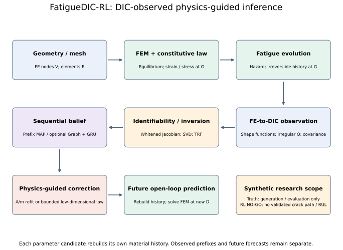
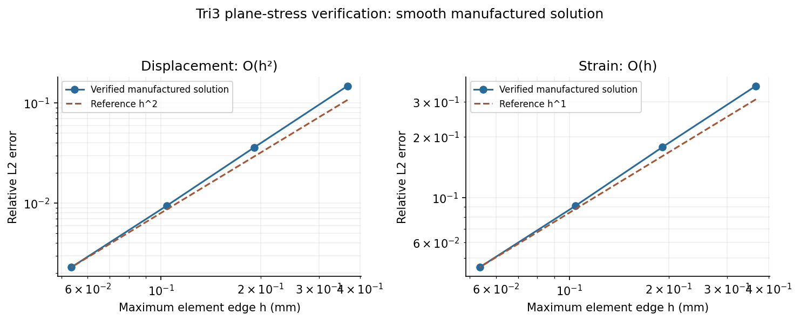
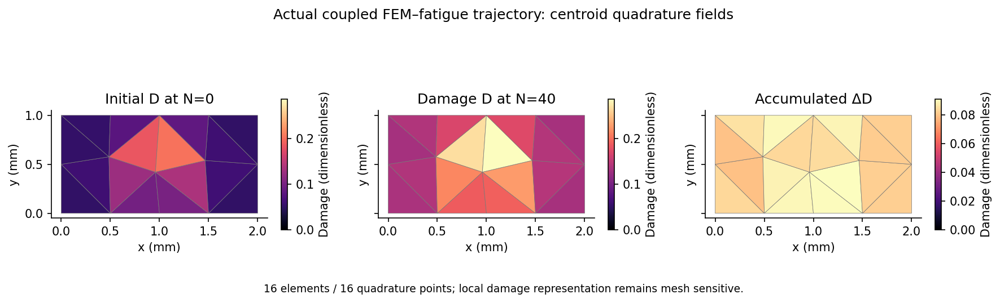
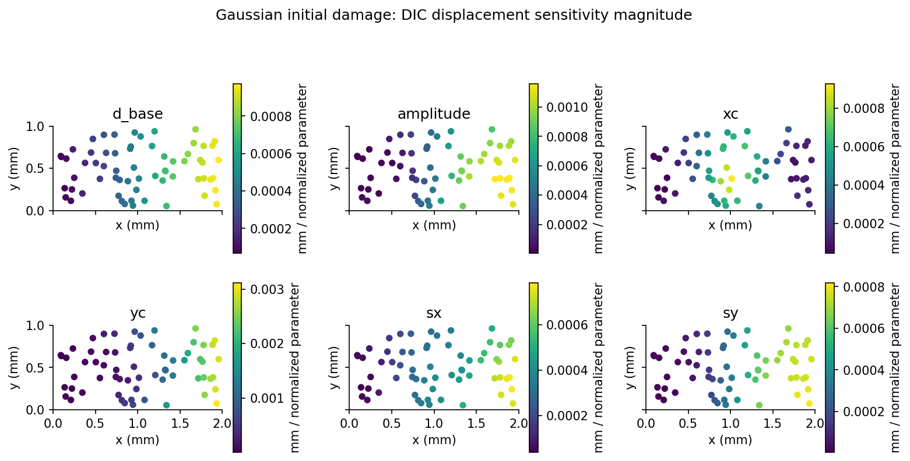
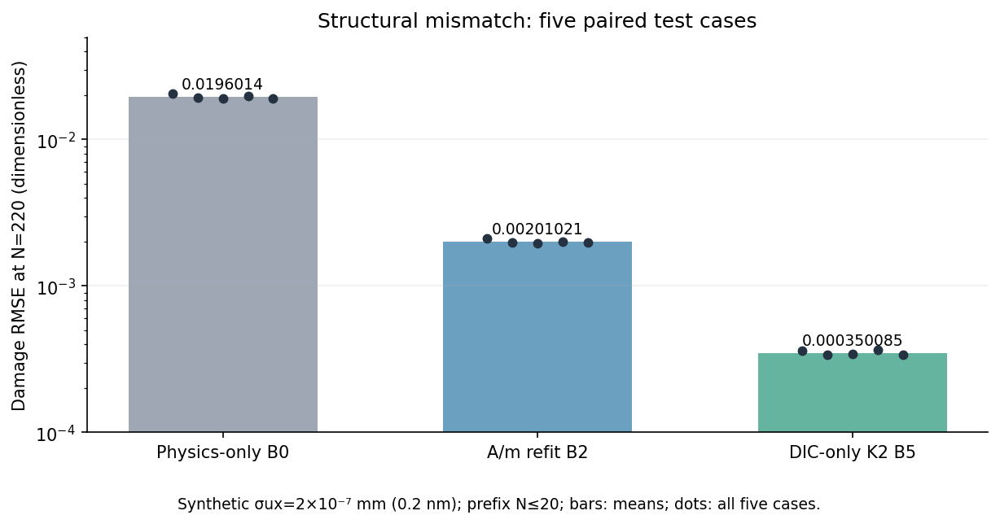
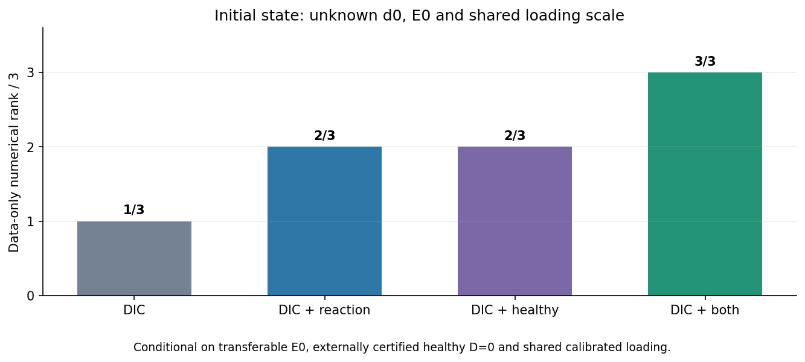

# FatigueDIC-RL

**DIC-Observed Physics-Guided Fatigue Damage Identification and Evolution**

[中文说明](README_CN.md) · [Methods](#mathematical-formulation) · [Verification](#verified-results) · [Limitations](#scope-and-limitations)

> **Research software / qualification notice.** The name preserves the original reinforcement-learning research vision, but **no RL policy has been scientifically qualified or deployed**. The current implementation contains a verified *scope-limited* finite-element/damage forward model, inverse DIC observation modeling, sequential belief estimation, graph-recurrent neural estimators, and low-dimensional physics-based damage-law correction. **RL remains NO-GO** pending stronger evidence of observability and decision value. Results below come from the documented **synthetic** benchmarks, not calibrated fatigue experiments.

## Overview

Digital image correlation (DIC) measures surface displacement but does not directly measure an internal fatigue-damage state. This project studies a mechanics-constrained workflow for inferring low-dimensional initial-damage parameters and their physically evolved fields from irregular full-field DIC observations, tracking it through cyclic loading, diagnosing identifiability and model discrepancy, and predicting future responses. The objective is to separate **what the displacement data actually identify** from quantities inferred primarily through material priors.



The existing framework deliberately keeps the mechanics solver, fatigue constitutive law, observation operator, classical inverse solver, and learned estimator separate. Synthetic truth and observation-only inference have different data interfaces.

## Mathematical formulation

### FEM and constitutive mechanics

The scope-qualified first model is small-strain, plane-stress, isotropic scalar damage on an unstructured triangular (Tri3) finite-element mesh:

$$
\boldsymbol\varepsilon=\tfrac12(\nabla\mathbf u+\nabla\mathbf u^\top),\quad
\nabla\cdot\boldsymbol\sigma+\mathbf b=0,\quad
\boldsymbol\sigma=(1-D)\mathbf C_0:\boldsymbol\varepsilon,\quad 0\le D<D_{\max}<1.
$$

The discrete equilibrium is

$$
\mathbf K(D)\mathbf u=\mathbf f,\qquad
\mathbf K(D)=\sum_e\sum_{g\in e}t\,w_g\mathbf B_e^\top\mathbf C(D_g)\mathbf B_e.
$$

Here $t$ is thickness, $w_g$ is physical quadrature area, and $\mathbf B_e$ maps nodal displacement to engineering strain $[\varepsilon_{xx},\varepsilon_{yy},\gamma_{xy}]^\top$. The plane-stress undamaged tangent is

$$
\mathbf C_0=\frac{E_0}{1-\nu^2}
\begin{bmatrix}1&\nu&0\\\nu&1&0\\0&0&(1-\nu)/2\end{bmatrix}.
$$

Sparse assembly, Dirichlet elimination, reactions and energy checks use the [Tri3 backend](src/fatigue_dic_rl/mechanics/tri3.py). The supports are explicit: FE nodes $V$ carry $u[V,2]$; elements $E$ carry connectivity $[E,3]$; quadrature points $G$ carry damage/history $D[G]$ and strain/stress $[G,3]$; DIC points $Q$ carry physical coordinates and displacement $[Q,2]$. These counts and locations are distinct, even when a particular Tri3 run has one quadrature point per element. Material internal state is stored at quadrature points; nodal FE fields, element fields, quadrature fields, and arbitrary DIC query points are not assumed to coincide. The simple stiffness law is one interchangeable constitutive model, **not** a claim that all fatigue damage is scalar elastic degradation.

### Fatigue damage evolution

A synthetic, energy-amplitude-driven benchmark law is used:

$$
\boldsymbol\varepsilon_a=(\boldsymbol\varepsilon_{max}-\boldsymbol\varepsilon_{min})/2,\qquad
Y_a=\tfrac12\boldsymbol\varepsilon_a:\mathbf C_0:\boldsymbol\varepsilon_a,\qquad
\lambda_{\mathrm{phys}}=A\left\langle\frac{Y_a}{Y_{\mathrm{ref}}}-\eta\right\rangle_+^m\exp(\beta_R R).
$$

Here $Y_a,Y_{\mathrm{ref}}$ have units N/mm², $A$ has units cycle⁻¹, and $m,\eta,\beta_R,R$ are dimensionless. $R$ is the declared minimum-to-maximum proportional loading ratio. Using the difference of endpoint energies would incorrectly remove the driver under fully reversed loading. The implementation is in [fatigue/models.py](src/fatigue_dic_rl/fatigue/models.py).

The nonnegative hazard parameterization is integrated with an irreversible frozen-hazard update:

$$
D_{k+1}=D_{\max}-(D_{\max}-D_k)\exp(-\Delta N_k\lambda_k).
$$

Each accepted step solves the loading extrema on the *current* damage state, evaluates the driving force, updates damage, then **re-solves FEM at the new state**. Step rejection and material-history rollback are explicit. The update is exact only for a hazard frozen over that increment; nonlinear coupled fatigue evolution remains time-discretization dependent. This fatigue law is a reproducible **synthetic reference**, not a calibrated Lemaitre/Chaboche law.

### DIC observation operator and likelihood

$$
\mathbf y_k^{\mathrm{DIC}}=\mathbf P_{\mathrm{FE}\to\mathrm{DIC}}\mathbf u_k^{\mathrm{FE}}+\boldsymbol\eta_k,
\qquad
\mathcal L_{\mathrm{obs}}=\tfrac12(\mathbf y^{\mathrm{pred}}-\mathbf y^{\mathrm{obs}})^\top\boldsymbol\Sigma^{-1}(\mathbf y^{\mathrm{pred}}-\mathbf y^{\mathrm{obs}}).
$$

The interpolation operator uses Tri3 shape functions at arbitrary physical query points. Explicit unit conversion, validity/ROI masks, per-component and spatially correlated covariance, and shared registration nuisance variables are supported in the verified settings. The statistical implementation uses covariance factorizations rather than materializing a dense inverse.

For active observations, $\Sigma=LL^\top$ is measured in mm² and the Gaussian negative log likelihood is

$$
-\log p(\mathbf y\mid\theta)=\tfrac12\|L^{-1}(\widehat{\mathbf y}(\theta)-\mathbf y)\|^2
+\tfrac12\log\det\Sigma+\tfrac{n_{obs}}2\log(2\pi).
$$

An independent reaction residual uses its own uncertainty in N. The full covariance is restricted to active points **before** whitening; confidence scores are not inverse variances. Shared registration is a common nuisance parameter, not independent evidence repeated at each frame. See [covariance](src/fatigue_dic_rl/observations/covariance.py) and [forward adapter](src/fatigue_dic_rl/inverse/forward_adapter.py).

### Damage identifiability

$$
J_w=L^{-1}\frac{\partial\widehat{\mathbf y}}{\partial\theta},\qquad
F_{data}=J_w^\top J_w,\qquad J_w=USV^\top.
$$

Centered finite differences use bounded, dimensionless parameter coordinates. Data rank, weak/null directions and prior-constrained rank are reported separately. With a prior, $F_{post}=F_{data}+F_{prior}$; prior constraints are not new DIC information. A rank-deficient identifiable-subspace pseudoinverse is not a finite covariance in every parameter direction.

A whitened sensitivity matrix $J_w=L^{-1}\partial\mathbf y/\partial\boldsymbol\theta$ and its singular spectrum are used to diagnose locally identifiable, weak, and null parameter directions. **Full numerical rank is not equivalent to accurate recovery**; the uniform relation $E_{\mathrm{eff}}=E_0(1-D)$ gives an exact modulus–damage confounding example.

### Physics-based sequential belief estimation

The first parameter space is $\theta=[d_0,A]$ with known $E_0$ and boundary conditions; Gaussian initial damage uses six spatial parameters; its amplitude is distinct from fatigue-law $A$, and evolved damage is not assumed to remain Gaussian. The belief concerns parameters, not arbitrary independent damage at $G$ points:

$$
b_k(\theta)=p(\theta\mid o_{0:k}),\qquad
\widehat\theta_k=\arg\min_\theta\left\{
\frac12\sum_{j=0}^k\|L_j^{-1}(\widehat o_j(\theta)-o_j)\|^2+\mathcal R_{prior}(\theta)\right\}.
$$

Prefix MAP uses the Phase 1C bounded SciPy TRF optimizer. Warm starts change initialization, while the fixed prior and each observed likelihood enter once. Every candidate rebuilds a consistent initial material history and rolls out the actual fatigue solver. Damage at the parameter mean is a plug-in estimate, not generally the posterior mean of damage. [MechanicsBelief](src/fatigue_dic_rl/inference/belief_state.py) records rank, uncertainty status and provenance; [sequential_map.py](src/fatigue_dic_rl/inference/sequential_map.py) publishes updates atomically.

Pre-observation prediction, filtered estimates and future forecasts have explicit, distinct roles. For example, $N=0,10,20$ may be assimilated; $N=30,40$ then remain open-loop. No future DIC is used to correct those forecasts. The original shared-registration experiment achieved **89/100**, rather than 95/100, nominal 95% $d_0$ interval coverage; [the follow-up](docs/PHASE2A_UNCERTAINTY_FOLLOWUP.md) does not erase that result.

### Graph-recurrent neural estimator

Irregular DIC points define a coordinate-based graph; FE connectivity defines a separate graph. Mask-aware pooling or normalized shape-function aggregation transfers embeddings to FE nodes:

$$
\widetilde z_v=\frac{\sum_q P_{qv}z_q}{\sum_q P_{qv}},
\qquad e_k=o_k-\widehat o_k^-,\quad r_k=L_k^{-1}e_k,
$$

with unsupported nodes masked. This aggregation is a feature operation, not covariance precision addition. Physics prediction uses the current parameter candidate. The causal network combines graph encodings, public loading, cycle count and $\Delta N$:

$$
z_k=Encoder(G_{DIC},G_{FE},r_k,\widehat o_k^-,\ell_k,N_k,\Delta N_k),\qquad
h_k=GRU(h_{k-1},z_k),
$$

$$
\widehat\zeta_k=\tanh(Head_\theta(h_k)),\qquad
\Delta\zeta_k=\widehat\zeta_k-\widehat\zeta_{k-1},\qquad
\widehat\theta_k=c+s\odot\widehat\zeta_k.
$$

Here $\zeta\in[-1,1]^K$ is the explicit dimensionless parameter coordinate. The implemented head emits a bounded new estimate and records the correction relative to the previous estimate. A Cholesky head gives $C_\zeta=TT^\top$ with positive diagonal. Its learned covariance is evaluated separately and is **not a calibrated mechanics posterior**. Updated parameters trigger a fresh consistent physics history.

The starting architecture uses 64 hidden channels, three graph message-passing layers and one graph-level GRU. The optional native-PyTorch [network](src/fatigue_dic_rl/networks/temporal_gru.py) uses SiLU residual message passing and a graph-level GRU. Synthetic labels support supervised amortized inference; NumPy/SciPy FEM features are stop-gradient inputs. There is no claimed PyTorch differentiation through the sparse solver and no required PyTorch Geometric dependency.

### Bounded damage-law correction

For an imperfect physics prior, the research prototype considers

$$
\lambda_{\mathrm{hybrid}}=\lambda_{\mathrm{prior}}\exp\!\left[\alpha\tanh\!\left(\sum_{j=1}^{K}a_j\phi_j(\mathbf x,\mathbf s_k)\right)\right].
$$

The implemented energy basis uses $t_x=x/(1+x)$ and $\phi_j=t_x^j$ for $j=1,\ldots,K$, with $x=\langle Y_a/Y_{ref}-\eta\rangle_+$. Its multiplicative form cannot create damage where the prior hazard is exactly zero. See [correction_basis.py](src/fatigue_dic_rl/correction/correction_basis.py) and [HybridDamageLaw](src/fatigue_dic_rl/correction/hybrid_damage_law.py).

The main tested correction is **low-dimensional** ($K=2$) and does not output a free damage action at every FE integration point. Physics-only, refitted $A$, refitted $(A,m)$, and DIC-only correction are separately evaluated. No trained actor–critic, SAC, TD3, or PPO result is claimed.

### Model selection and experimental design

Frozen B7 chooses among physics, $A/m$ refit and $K=2$ correction using allowed historical residuals and observability screens; B8 adds a historical gate. Phase 2E E9 is an independently named selection method. Designs compare uniform/random points, Fisher information and model discrimination under measurement/loading budgets. For two fitted candidate models,

$$
 d_w=L^{-1}(y_1-y_2),\qquad
 d_\perp=(I-U_nU_n^\top)d_w,
$$

where $U_n$ is the resolved SVD basis of the whitened nuisance Jacobian. A large raw difference may disappear after load, modulus or registration adjustments. Local separation is a diagnostic, not a calibrated selection success probability. **ABSTAIN** is valid when information is insufficient. Static loading probes the current stiffness; fatigue excitation actually advances cycles and damage. Neither is an RL policy.

## Implemented methods

| Subsystem | Implemented scope | Primary documentation |
|---|---|---|
| Core fields and FE–DIC interfaces | Irregular meshes/observations, explicit field locations and units | `docs/` Phase 0 report |
| Mechanics solver | Sparse Tri3 small-strain plane-stress FEM; BCs, loads, reactions, energy | [Phase 1A](docs/PHASE1A_MECHANICS_VERIFICATION_REPORT.md) |
| Fatigue evolution | Proportional cyclic loading, quadrature history, nonnegative hazard, rollback | [Phase 1B](docs/PHASE1B_FATIGUE_EVOLUTION_REPORT.md) |
| DIC inverse problem | Noise/covariance, parameterizations, Fisher/SVD, bounded TRF inversion | [Phase 1C](docs/PHASE1C_IDENTIFIABILITY_REPORT.md) |
| Sequential belief | Prefix MAP, information rank, uncertainty diagnostics, temporal holdout | [Phase 2A](docs/PHASE2A_SEQUENTIAL_BELIEF_REPORT.md) |
| Graph + GRU | Synthetic-supervised, graph-recurrent amortized estimator | [Phase 2B](docs/PHASE2B_GRAPH_RECURRENT_ESTIMATOR_REPORT.md) |
| Physics correction | Global bounded low-rank correction and A/m calibration comparisons | [Phase 2C](docs/PHASE2C_PHYSICS_CORRECTION_REPORT.md) |
| Selection / experimental design | Observability screens, matched controls, load/force/healthy reference diagnostics | [Phase 2D](docs/PHASE2D_ROBUSTNESS_AND_MODEL_SELECTION_REPORT.md), [Phase 2E](docs/PHASE2E_OBSERVABILITY_AND_DESIGN_REPORT.md), [Phase 2F](docs/PHASE2F_INFORMATION_SUFFICIENCY_REPORT.md) |

## Verified results

These are **specific benchmark results, not general performance guarantees**. Consult each linked report for the exact geometry, measurement noise, seed counts, discretization, and comparison budget.

### 1. Tri3 FEM verification



In the tested smooth manufactured-solution problem, the final two mesh levels gave displacement and strain convergence rates of approximately **2.130** and **1.055**, respectively, consistent with first-order finite-element interpolation expectations. This does **not** establish convergence for material softening or cracks. See [Phase 1A](docs/PHASE1A_MECHANICS_VERIFICATION_REPORT.md).

### 2. Coupled fatigue fields and identifiability



The Phase 1B localized example evolves a continuous initial Gaussian field sampled at **16 centroid quadrature points** on 16 Tri3 elements, from $N=0$ to $N=40$. These are actual coupled FEM–damage fields, including accumulated increments. The coarse local model has explicit mesh sensitivity; this picture is not a crack-path prediction. [Phase 1B evidence](docs/PHASE1B_FATIGUE_EVOLUTION_REPORT.md).



Phase 1C distinguishes the six initial Gaussian parameters through different displacement sensitivities at 64 irregular observation points. The [whitened spectrum](docs/assets/readme/identifiability_spectrum.svg) has numerical rank six, but only four singular values exceed the unit-noise scale. This illustrates why full rank is insufficient for accurate inversion. Unknown uniform modulus and damage can still be strictly equivalent. [Phase 1C evidence](docs/PHASE1C_IDENTIFIABILITY_REPORT.md).

### 3. Damage-law correction under structural mismatch



In the **high-SNR synthetic structural-mismatch** study, five paired cases showed an approximately **82.7% median reduction** in long-horizon damage RMSE for a $K=2$ DIC-only correction relative to an $(A,m)$ refit. At $N=220$, mean damage RMSE is **0.0196014** (physics prior), **0.00201021** ($A/m$ refit), and **0.000350085** (DIC-only K2). The five cases share one structural-law family and are not five independent material mechanisms. The main observation noise was **$2\times10^{-7}$ mm (0.2 nm)**, an exceptionally favorable synthetic setting. In parameter-mismatch cases, classical $A/m$ refitting was more accurate; unnecessary correction can worsen correctly specified physics. See [Phase 2C](docs/PHASE2C_PHYSICS_CORRECTION_REPORT.md).

### 4. Initial-state identifiability



For the **controlled uniform-damage, shared-modulus/load** three-parameter model, data-only information rank increased from **1/3** (DIC alone) to **2/3** when either an independent reaction or certified healthy reference was added, and to **3/3** with both. However, *unknown modulus transfer between healthy and damaged specimens* reintroduces ambiguity; the combined result is conditional, not a demonstration of general unique damage identification. See [Phase 2F](docs/PHASE2F_INFORMATION_SUFFICIENCY_REPORT.md) and [Validation readiness](docs/SCIENTIFIC_BASELINE_AND_VALIDATION_READINESS.md).

### 5. Neural inference and independent testing

- The Phase 2B graph-recurrent estimator gave an approximately **18.5×** speedup for a specified isolated-CPU parameter-belief benchmark, **while classical MAP remained more accurate**. This is not a guaranteed whole-pipeline acceleration.
- Neural uncertainty was not reliably calibrated: in fixed-noise tests, nominal 95% coverage fell to **76%** for fatigue $A$ and **55%** for future $D_{40}$ in some settings.
- Phase 2D evaluated 160 scientific cases, with no incorrect K2 activations among 40 matched controls. Structural selection improved future error in **6/8** historical identifiable cases (**75%**, below its predeclared 80% gate).
- In Phase 2E independent structural design tests, the Fisher design met the structural benefit gate in **1/8** cases and the discrimination design in **0/8**.
- Phase 2F and the subsequent readiness study showed that healthy-reference/force information helps initial-state inference but does not, by itself, distinguish the $(A,m)$ law family from low-rank $K=2$ corrections. The formal 100-world initial-state validation remains **NO-GO** pending transfer and sensor calibration.

Detailed numerical evidence and qualifications: [2B](docs/PHASE2B_GRAPH_RECURRENT_ESTIMATOR_REPORT.md) · [2D](docs/PHASE2D_ROBUSTNESS_AND_MODEL_SELECTION_REPORT.md) · [2E](docs/PHASE2E_OBSERVABILITY_AND_DESIGN_REPORT.md) · [Readiness](docs/SCIENTIFIC_BASELINE_AND_VALIDATION_READINESS.md).

### Verification status

The publication rerun of `python -m pytest -q -W error` completed **514 tests with no skips in 490.64 s**, matching the latest readiness result; this is a reported frozen-source regression result, not a claim that every old expensive scientific CLI was rerun in that stage. Historical phase qualifications and limitations are retained in their original reports.

## Installation and usage

Requires **Python ≥3.11**. The base package depends on NumPy; sparse mechanics adds SciPy, scientific figures add Matplotlib, and tests add pytest. Dependency lower bounds are in [pyproject.toml](pyproject.toml); they are not a fully locked environment. The publication regression runs on Linux/Python 3.13.12, NumPy 2.4.4, SciPy 1.17.1 and an installed CPU-accessible PyTorch build.

```bash
# Numerical environment; run from the repository root
python -m venv .venv-numerics
source .venv-numerics/bin/activate
python -m pip install -e '.[test,verification]'
PYTHONPATH=src python -m pytest -q -W error
```

The numerical installation **reports neural tests as skipped** if PyTorch is absent; it does not reproduce the full 514-test result. For the complete regression, use a separate neural environment:

```bash
python -m venv .venv-neural
source .venv-neural/bin/activate
python -m pip install -e '.[test,verification,neural]'
PYTHONPATH=src OPENBLAS_NUM_THREADS=1 OMP_NUM_THREADS=1 python -m pytest -q -W error
```

Choose a PyTorch build suitable for your CPU/GPU. CUDA is optional and was unavailable to the recorded neural training runs. No training is needed for the following quick numerical examples. Each CLI rejects an existing output directory:

```bash
FATIGUEDIC_DEMO=$(mktemp -d /tmp/fatiguedic-demo.XXXXXX)

# Affine Tri3 patch: displacement, strain, reaction and equilibrium checks
PYTHONPATH=src python -W error scripts/verify_phase1a.py \
  --config configs/phase1/tri3_patch_test.toml \
  --output "$FATIGUEDIC_DEMO/tri3-patch"

# Coupled uniform fatigue evolution, force and displacement control
PYTHONPATH=src python -W error scripts/verify_phase1b.py \
  --config configs/phase1b/uniform_damage.toml \
  --output "$FATIGUEDIC_DEMO/uniform-fatigue"

# DIC inverse / identifiability: equivalent E0–damage solutions
PYTHONPATH=src python -W error scripts/verify_phase1c.py \
  --config configs/phase1c/uniform_confounding.toml \
  --output "$FATIGUEDIC_DEMO/uniform-identifiability"
```

Outputs include `summary.json`, copied configuration, solver logs and, depending on the case, numeric CSV/NPZ fields and PNG/SVG figures. The fatigue example saves mechanics/damage trajectories; the identifiability example records Jacobians, spectra and equivalent parameter solutions. A `PASSED` ambiguity diagnostic means the ambiguity was correctly detected, not uniquely solved. [CLI documentation](docs/PHASE1B_FATIGUE_EVOLUTION_REPORT.md) describes other frozen experiments; later statistical/training scripts can be substantially more expensive.

Real DIC ingestion requires calibrated physical coordinates/displacements, aligned axes, explicit units, valid/ROI masks, justified covariance and known loading. The code operates on irregular observations, not raw camera images. It does not perform image correlation, camera distortion correction or stereo reconstruction. Synthetic truth loaders must never supply inference features.

The CI has separate numerical and explicit-PyTorch regression jobs. Remote CI status must be checked for the published branch; local success is not evidence that every CI environment passed.

## Repository organization

```text
src/fatigue_dic_rl/
  core/           # field and state contracts
  geometry/       # meshes, Tri3 geometry, quadrature
  mechanics/      # FE solver interfaces and Tri3 backend
  materials/      # constitutive models
  fatigue/        # cyclic loading, history, damage-law evolution
  observations/   # DIC mapping, covariance, registration
  inverse/        # parameterizations, sensitivity, TRF inversion
  inference/      # sequential and neural belief estimators
  networks/       # optional irregular-graph and GRU components
  correction/     # bounded law corrections, model selection
  training/       # optional synthetic learning workflows
  evaluation/     # scientific comparison and plotting
configs/          # phase-specific frozen experiments
scripts/          # verify, generate, train, evaluate, audit
tests/           # unit / integration / scientific
docs/             # methods and phase-specific evidence reports
```

## Scope and limitations

- **No scientifically qualified RL policy** or reliable policy-based experimental control. RL remains **NO-GO**.
- The primary mechanics path is **2D Tri3, small-strain, isotropic plane-stress, scalar local damage**; no validated 3D, plasticity, contact, crack path, or real-material fatigue-life prediction.
- The fatigue benchmark law and DIC noise models are **synthetic**, not calibrated to a laboratory material/camera.
- Local damage localization has **mesh sensitivity**; mesh-objective localization is not qualified.
- DIC-only inference can be **structurally non-identifiable**, especially for unknown $E_0$, damage and loading scales.
- Additional healthy reference information is useful only under explicit material-transfer and measurement assumptions. Those nuisance effects are not yet adequately calibrated.
- Amortized neural point estimates and approximate covariance are not interchangeable with a reliable posterior. OOD, clustered measurements, unknown loading and shared registration require care.
- Formal independent 100-world readiness validation has **not started**.

## Reproducibility and research assets

The Git repository is intended to contain source, small fixtures, tests, frozen configurations, methods and evidence indices. Original report links into `results/` refer to external research evidence and do not resolve in a source-only Git clone. Full public asset hosting is not yet confirmed; curated exact figure extracts and their source hashes are included. Generated FE fields, raw noisy trajectories, optimizer histories, large scientific runs and checkpoints remain in separately archived, SHA-256-verified scientific assets. Original phase reports preserve incomplete/negative results; figures in this README are curated summaries, **not new independent experiments**.

The original phase baselines were developed before formal Git commits. Preserve the documented Phase 2E/2F source manifests and use actual commit dates when importing consolidated baselines; do not fabricate historical stage commits. See the [scientific evidence index](docs/reproducibility/SCIENTIFIC_SOURCE_EVIDENCE.json), [figure provenance](docs/assets/readme/ASSET_PROVENANCE.md), [publication audit](docs/GITHUB_PUBLICATION_REPORT.md), [Git freeze readiness](docs/PHASE2E_GIT_FREEZE_READINESS.md) and [Validation readiness](docs/SCIENTIFIC_BASELINE_AND_VALIDATION_READINESS.md).

## Citation and license

Code and project-generated figures are released under the **MIT License**; no third-party paper images are included. If you build on this project, please cite the repository and, when available, the associated peer-reviewed publication. A publication DOI and citation entry have **not** yet been declared here; please do not invent one. Cite the repository and the exact commit/tag used; there is no declared publication DOI:

```bibtex
@misc{fatiguedicrl2026,
  author = {FatigueDIC-RL contributors},
  title = {FatigueDIC-RL: DIC-Observed Physics-Guided Fatigue Damage Identification and Evolution},
  year = {2026},
  howpublished = {\url{https://github.com/lbd-hfut/FatigueDIC-RL}},
  note = {Research software; cite the source commit or scientific baseline tag}
}
```

See [LICENSE](LICENSE).

---

*Research direction: DIC-observed internal-state identification and physics-constrained fatigue evolution. Reinforcement-learning extensions remain a research hypothesis, not a verified result.*
