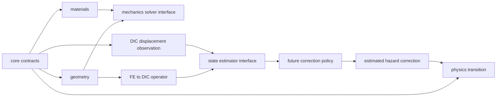

# 01 — 系统架构与依赖

## 已实现边界

`core` 定义不可变数值场、空间引用、载荷和状态角色，只依赖 NumPy。
`geometry` 定义网格拓扑，依赖 core。
`materials` 定义独立本构与 DamageLaw，依赖 core。
`physics` 负责硬约束与解析损伤更新，不导入 RL。
`mechanics` 定义 solver 的输入、输出、边界条件和错误，不加载 FE backend。
`observations` 持有 DIC 观测及网格形函数算子，不依赖 solver。
`inference` 和 `rl` 当前提供契约与代数修正，不包含可训练网络。

箭头表示数据/契约流向，实际 Python import 均沿基础层向上使用。
`smoke.py` 组合 geometry/materials/physics/observations，既不导入 RL，也不调用 solver。
模块导入不执行训练、不读取外部数据、不启动 GPU。

## 两类环境

真实/可信 synthetic physical environment 演化真实状态、产生位移观测。
ground truth 只向 dataset 的受控 truth 通道和 evaluation 暴露。
model prediction environment 演化估计状态，可接受 latent correction、用于未来多步评价。
两种环境不能共享可写状态或把预测动作传回真实演化函数。
Phase 0 没有环境实现；在 environments 目录保存此边界说明。

## Physics-only 路径

将参数、边界条件与 damage 提交给未来 MechanicsSolver；将得到的状态和 CycleLoading
提交给 DamageLaw；将其 hazard 提交给 DamageTransition；在新损伤下重新求解。
将节点位移通过 ObservationOperator 投影到观测点，形成位移预测残差。
整个路径无需 correction policy。当前通过解析位移场验证后半段契约。

## 扩展点

| 扩展 | 所需接口 | 独立验证要求 |
|---|---|---|
| tri3 小应变 FE | MechanicsSolver._solve | patch test、刚体模态、反力、网格收敛 |
| FEniCSx/其他 backend | 同一 SolverRequest/Result 适配 | 与参考解对照、参数和单位转换 |
| 疲劳物理模型 | DamageLaw._hazard + 显式注册表 | 校准、循环历史、步长收敛 |
| quad4 观测 | 新形函数适配器 | 等参逆映射、边界与畸变验证 |
| GNN/时序估计器 | StateEstimator._update | 可识别性、噪声鲁棒性、truth 隔离 |
| latent 策略 | DamageCorrectionPolicy._action | 有效动作支持、多步价值、RL 消融 |
| 可微 solver/代理模型 | 同一力学和数据契约 | 前向精度、梯度验证、域外检测 |

quadrature reference 必须指明具体布局版本，不能由节点数量推断。
材料区域支持非均匀刚度；本轮仅验证赋值契约，没有验证不同区域的 FE 平衡。

## 实施约定

采用 src-layout、NumPy 核心、pytest 三类测试。新算法应随科学验收证据一起加入。
未开发子系统只保存 README 说明，避免无用途的占位类。
结果、实验原始数据和旧代码不得通过 reset/clean/restore 等操作删除。
本轮在 feature 分支保留待审查改动，没有提交、push、merge 或 release。
局部数值数组不可写，metadata 为描述性映射；metadata 内部的任意对象没有深度冻结保证，
因此禁止将它当作物理值、空间布局或缓存身份的依据。
